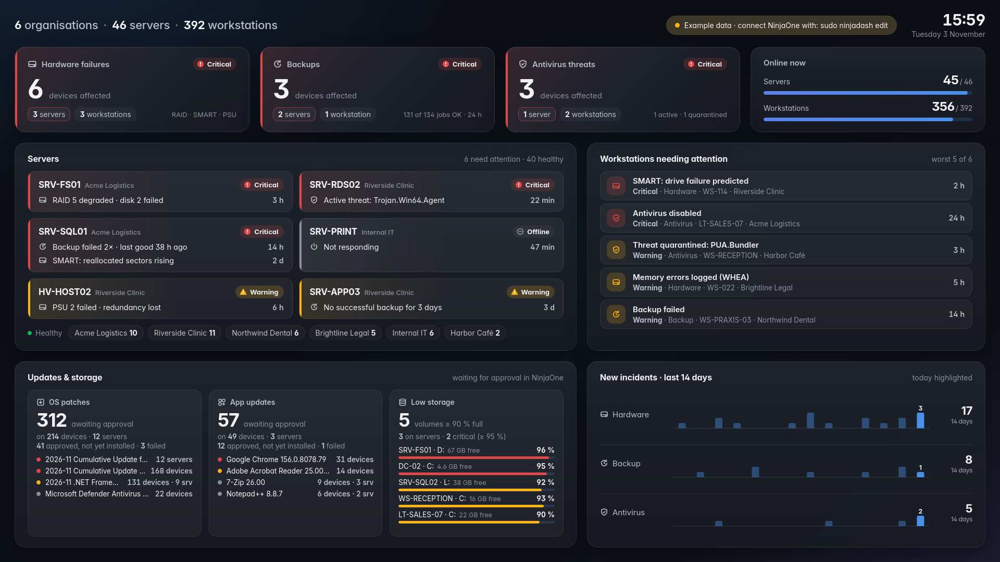

# NinjaDash

A calm, good-looking wall dashboard for **NinjaOne RMM**. It runs on a small (old) MSI mini PC in
kiosk mode on a 1080p TV and focuses on three things: **hardware failures**, **failed backups** and
**antivirus threats**. It shows which **servers** are affected first, then workstations.



- Boots **straight into the dashboard**, full screen, no login screen, no mouse pointer
- **Updates & storage** panel: OS patches and app updates waiting for approval, low disk space
- **Screen schedule** built in: on and off at set times, off at weekends and on holidays, no Home Assistant needed
- **Home Assistant** can also switch the TV picture off/on and choose light or dark colours
- **Remote Desktop (RDP)** for maintenance while the TV keeps showing the dashboard
- **Strictly read-only** access to NinjaOne ([details](#read-only-access-to-ninjaone)); the API secret never leaves the mini PC
- Lists fit themselves to the screen: the most important items stay, the rest becomes "+N more"

**Contents:** [Install](#install) · [Command reference](#command-reference) · [Connect NinjaOne](#connect-ninjaone) ·
[Read-only](#read-only-access-to-ninjaone) · [Screen schedule](#screen-schedule-no-home-assistant-needed) · [Light and dark](#light-and-dark-mode) · [Home Assistant](#home-assistant-screen-onoff) ·
[Remote Desktop](#remote-desktop-rdp) · [TV: dashboard or KDE](#tv-dashboard-or-kde) · [Dashboard panels](#what-the-dashboard-shows) ·
[Alert rules](#alert-rules) · [Settings](#settings) · [Update](#update) · [Troubleshooting](#troubleshooting) · [Files](#files) · [Uninstall](#uninstall) · [Development](#development)

---

## Install

On the mini PC (Arch Linux / CachyOS), in a terminal, from your normal user account.

### Install or update: one command

```bash
curl -fsSL https://raw.githubusercontent.com/Bot320/NinjaDash/main/get.sh | bash
```

This downloads the newest version to `~/ninjadash-src` and runs the installer. For an update that's all:
your settings, token, rules and Home Assistant setup are kept. Then `sudo reboot`.

The first install, with the Home Assistant screen switch:

```bash
curl -fsSL https://raw.githubusercontent.com/Bot320/NinjaDash/main/get.sh | bash -s -- --home-assistant
```

Test a branch (e.g. from a pull request) instead of `main`:

```bash
curl -fsSL https://raw.githubusercontent.com/Bot320/NinjaDash/main/get.sh | bash -s -- --branch fix/kiosk-polish
```

> **Copy and paste:** on GitHub, every grey box has a **copy button** in its top-right corner.
> In a Linux terminal, paste with **Ctrl+Shift+V** or right-click → *Paste* (plain Ctrl+V doesn't work).
> On the text console (Ctrl+Alt+F2) there is no clipboard, so type the one-line command above by hand.

### After installing

```bash
sudo bash ~/ninjadash-src/deploy/setup-rdp.sh   # Remote Desktop (optional, recommended)
sudo ninjadash edit                             # NinjaOne Client ID + Secret (see below)
sudo ninjadash check                            # test the NinjaOne connection
sudo ninjadash home-assistant                   # configuration for Home Assistant
sudo reboot                                     # from now on it boots into the dashboard
```

### Step by step, without the one-liner

```bash
curl -L -o ninjadash.tar.gz https://github.com/Bot320/NinjaDash/archive/refs/heads/main.tar.gz
tar xzf ninjadash.tar.gz && cd NinjaDash-main
sudo bash deploy/install.sh --home-assistant
```

Installer options:

| Command | What you get |
|---|---|
| `sudo bash deploy/install.sh` | **Kiosk:** the TV shows only the dashboard at boot. Disables the login screen (SDDM) after asking |
| `… --desktop USER` | Keeps the desktop; the dashboard opens full screen when `USER` logs in |
| `… --backend-only` | Only the service; open `http://localhost:8080` in a browser yourself |
| `… --home-assistant` | Also lets Home Assistant switch the screen (combine with any of the above) |
| `… --yes` | Answers "yes" to every question |

Until the NinjaOne API client is filled in, the dashboard shows **example data** with an amber note at the top.

---

## Command reference

Everything goes through the `ninjadash` helper (installed to `/usr/local/bin`).

### Everyday

| Command | Does |
|---|---|
| `sudo ninjadash status` | Shows whether the dashboard service and the kiosk screen are running |
| `sudo ninjadash logs` | Follows the log live (Ctrl+C to stop) |
| `sudo ninjadash restart` | Restarts the service and the kiosk, e.g. after editing settings or rules |
| `sudo ninjadash edit` | Opens the settings file (`/etc/ninjadash/ninjadash.env`) in nano |
| `sudo ninjadash check` | Tests the NinjaOne login and shows what each tile will show. Changes nothing in NinjaOne |
| `sudo ninjadash check --fields` | The same, plus the field names NinjaOne returns (send this when something looks wrong) |
| `sudo ninjadash patches` | The patch statuses and fields exactly as NinjaOne sends them, on one screen (take a photo when the patch numbers look wrong) |

### Screen

| Command | Does |
|---|---|
| `ninjadash screen off` | Turns the TV picture off (cuts the HDMI signal) |
| `ninjadash screen on` | Turns it back on |
| `ninjadash screen toggle` | Switches between on and off |
| `ninjadash screen status` | Shows the state. `"agent": true` means the kiosk's screen control is connected |
| `ninjadash theme dark` / `light` | Dark or light colours (stays like that until changed, also after a reboot) |
| `ninjadash theme auto` | Automatic: light between `LIGHT_FROM` and `LIGHT_UNTIL`, dark otherwise |
| `ninjadash theme toggle` / `status` | Swap light and dark / show the current setting |
| `ninjadash schedule` | Shows the screen schedule and when the screen switches next |
| `sudo ninjadash schedule set 07:00 19:00 mon-fri` | Screen on at 07:00, off at 19:00, Monday to Friday. Weekends stay off |
| `sudo ninjadash schedule holidays 2026-12-24..2027-01-01` | Extra days the screen stays off (comma-separated, `..` for ranges) |
| `sudo ninjadash schedule off` | Removes the schedule |
| `sudo ninjadash pointer` | Hides the mouse pointer on the TV right now (normally automatic) |
| `sudo ninjadash home-assistant` | Prints the Home Assistant configuration (screen + dark mode) incl. IP and token |

### TV: dashboard or KDE

| Command | Does |
|---|---|
| `sudo ninjadash desktop` | Stops the dashboard on the TV and shows the normal login screen (KDE) |
| `sudo ninjadash kiosk` | Back to the dashboard. A reboot does the same |

### Services directly (systemd)

| Command | Does |
|---|---|
| `systemctl status ninjadash` | The backend (talks to NinjaOne, serves the page) |
| `systemctl status ninjadash-kiosk` | The TV screen (cage + Chromium on tty1) |
| `journalctl -u ninjadash -b` | Backend log since the last boot |
| `journalctl -u ninjadash-kiosk -b` | Kiosk log since the last boot (Chromium, screen agent) |
| `journalctl -u ninjadash-pointer -b` | Pointer helper log (hides the mouse pointer) |
| `sudo ninjadash diag` | Everything about the kiosk screen in one go (send this when something looks wrong) |
| `systemctl status xrdp xrdp-sesman` | Remote Desktop server |

### Keys at the mini PC

| Keys | Does |
|---|---|
| **Ctrl+Alt+F2** | Text console for logging in (the dashboard keeps running on tty1) |
| **Ctrl+Alt+F1** | Back to the dashboard |

### Scripts

| Command | Does |
|---|---|
| `sudo bash deploy/install.sh [options]` | Install or update (keeps your settings) |
| `sudo bash /opt/ninjadash/deploy/setup-rdp.sh [--user NAME]` | Set up Remote Desktop |
| `sudo bash /opt/ninjadash/deploy/uninstall.sh [--purge]` | Remove NinjaDash (`--purge` also deletes settings and history) |
| `bash deploy/make-bundle.sh` | Pack the project into `dist/ninjadash-<version>.tar.gz` |

---

## Connect NinjaOne

1. A NinjaOne **administrator** creates the API client: **Administration → Apps → API → Client App IDs → Add**
   - Application Platform: **API Services (machine-to-machine)**
   - Name: **NinjaDash**
   - Scopes: **Monitoring** only (read-only)
   - Allowed Grant Types: **Client Credentials**
   - After saving, copy the **Client Secret** right away; it's only shown once. The Client ID stays visible in the list.
   - No device or "infrastructure" needs to be added. The API client isn't tied to a computer.
2. On the mini PC (or over RDP):
   ```bash
   sudo ninjadash edit       # fill NINJA_CLIENT_ID= and NINJA_CLIENT_SECRET=, save: Ctrl+O, Enter, Ctrl+X
   sudo ninjadash check      # should say "✓ Logged in to NinjaOne"
   sudo ninjadash restart
   ```

The region is set with `NINJA_HOST` (default `eu.ninjarmm.com`).

---

## Read-only access to NinjaOne

NinjaDash only ever **reads** from NinjaOne. It can't approve patches, run scripts, reboot devices or change
anything else, and this is enforced in three places:

1. **The API client** in NinjaOne gets only the **Monitoring** scope (read-only). Don't tick Management or Control.
2. **The login** always asks NinjaOne for the `monitoring` scope only. That's fixed in the code
   (`backend/ninjadash/ninja.py`); a different `NINJA_SCOPE` in the settings is ignored.
3. **The code** only sends `GET` requests to `/v2/…`. The single exception is the login itself
   (`POST /ws/oauth/token`). The test `tests/test_readonly.py` runs a complete sync against a fake NinjaOne
   and fails if any other kind of request is sent.

The Home Assistant switches (`/api/screen`, `/api/theme`) only change the TV on the mini PC, never NinjaOne.

---

## Light and dark mode

| Setting | Colours |
|---|---|
| `auto` (default) | Light between `LIGHT_FROM` and `LIGHT_UNTIL` (07:00–19:00), dark otherwise |
| `light` / `dark` | Always light / always dark |

Switch it any of these ways. The last choice wins and is kept across reboots (in `/var/lib/ninjadash/state.json`):

- **Home Assistant:** the **NinjaDash dark mode** switch (on = dark, off = light) and `rest_command.ninjadash_theme_auto`
  (back to automatic). Both are in the block that `sudo ninjadash home-assistant` prints. To follow the sun:
  ```yaml
  automation:
    - alias: NinjaDash dark after sunset
      trigger: { platform: sun, event: sunset }
      action: { service: switch.turn_on, target: { entity_id: switch.ninjadash_dark_mode } }
    - alias: NinjaDash light after sunrise
      trigger: { platform: sun, event: sunrise }
      action: { service: switch.turn_off, target: { entity_id: switch.ninjadash_dark_mode } }
  ```
- **On the mini PC:** `ninjadash theme dark`, `ninjadash theme light`, `ninjadash theme auto`
- **The default** after a fresh install: `THEME=` and `LIGHT_FROM=` / `LIGHT_UNTIL=` in `sudo ninjadash edit`

The TV follows within 3 seconds.

---

## Screen schedule (no Home Assistant needed)

NinjaDash can switch the screen on and off by itself:

```bash
sudo ninjadash schedule set 07:00 19:00 mon-fri
```

That turns the screen on at 07:00 and off at 19:00, Monday to Friday. **On Saturdays and Sundays it stays
off all day**, also after a reboot. Check it with `ninjadash schedule`:

```
Screen on 07:00, off 19:00, on these days: mon,tue,wed,thu,fri
Right now the schedule says: on
Next: off on Tue 03 Nov 19:00
```

- **Days:** `mon-fri`, `mon,wed,fri`, `weekdays`, `daily`, `mon-sat`; German names work too (`mo-fr`)
- **Holidays / days off:** `sudo ninjadash schedule holidays 2026-12-24..2027-01-01,2027-04-05`
- **Off time after midnight** works too (e.g. `set 16:00 02:00 mon-fri`)
- **Manual switching still works:** Home Assistant or `ninjadash screen on` overrides the schedule
  until the next scheduled switch. Switch the screen on on a Saturday and it stays on until Monday 19:00.
- **Remove it:** `sudo ninjadash schedule off`
- Settings behind it (`sudo ninjadash edit`): `SCREEN_ON`, `SCREEN_OFF`, `SCREEN_DAYS`, `SCREEN_OFF_DATES`

**Screen timeout:** there is none. The kiosk has no screensaver or power saving that could blank the screen,
and the page also holds a screen wake lock. The screen only goes off through the schedule, Home Assistant or
`ninjadash screen off`.
**But check the TV itself:** many TVs switch themselves off after about 4 hours without a remote-control
button press, even with a picture (an EU energy-saving rule). Turn that off in the TV's menu. It's usually
called *Auto Power Off*, *Eco Solution → Auto Power Off* (Samsung), *Eco Mode → Auto Power Off* (LG), or
*Idle TV Standby* (Sony).

---

## Home Assistant: screen on/off

```bash
sudo ninjadash home-assistant
```

Paste the printed block into Home Assistant's `configuration.yaml` and restart Home Assistant. You get
**switch.ninjadash_screen**, **switch.ninjadash_dark_mode** and **rest_command.ninjadash_theme_auto**.
To keep the token out of `configuration.yaml`, put it in `secrets.yaml` (the screen switch as an example):

```yaml
# secrets.yaml
ninjadash_auth: "Bearer <token>"
```
```yaml
# configuration.yaml
switch:
  - platform: rest
    name: NinjaDash screen
    unique_id: ninjadash_screen
    resource: http://<mini-pc-ip>:8080/api/screen
    method: post
    body_on: '{"state": "on"}'
    body_off: '{"state": "off"}'
    is_on_template: "{{ value_json.on }}"
    headers:
      Authorization: !secret ninjadash_auth
      Content-Type: application/json
    scan_interval: 30
```

The API, for other tools or scripts:

```bash
curl -H "Authorization: Bearer <token>" http://<mini-pc-ip>:8080/api/screen                     # state
curl -X POST -H "Authorization: Bearer <token>" http://<mini-pc-ip>:8080/api/screen/off         # off
curl -X POST -H "Authorization: Bearer <token>" http://<mini-pc-ip>:8080/api/screen/on          # on
curl -X POST -H "Authorization: Bearer <token>" -d '{"state":"toggle"}' http://<mini-pc-ip>:8080/api/screen
curl -X POST -H "Authorization: Bearer <token>" http://<mini-pc-ip>:8080/api/theme/dark          # light | dark | auto | toggle
```

- From the network only `/api/screen` and `/api/theme` are reachable, and only with the token. The dashboard data stays on the mini PC.
- Off cuts the HDMI signal; most TVs then go to standby. The page also goes black as a fallback.
- Some TVs don't wake up when the signal returns. Then let Home Assistant switch the TV itself (LG webOS,
  Samsung, Sony Bravia and Android TV integrations), or use a USB HDMI-CEC adapter.
- After a restart of the service the screen is on.
- New token: delete the `SCREEN_TOKEN=` value with `sudo ninjadash edit`, re-run the installer, and update Home Assistant.

---

## Remote Desktop (RDP)

```bash
sudo bash /opt/ninjadash/deploy/setup-rdp.sh
```

Connect from the same network (or a VPN) with *Remote Desktop Connection* (Windows, `mstsc`), **Remmina**
(Linux) or *Windows App* (Mac) to the mini PC's IP. Log in with your Linux user and password. You get an
**XFCE** desktop; the TV keeps showing the dashboard.

- KDE isn't available over RDP: xrdp needs X11, and KDE Plasma 6.8 is Wayland-only. Use `sudo ninjadash desktop` to put KDE on the TV instead.
- xrdp is built from the AUR. Its unit tests 7–10 currently fail on Arch (login-screen image scaling), which is harmless; the script skips them. To rebuild by hand: `paru -S --needed --nocheck xrdp xorgxrdp`.
- After an Xorg update, if RDP shows a black screen or disconnects: `paru -S --rebuild --nocheck xorgxrdp`.
- Don't forward port 3389 on the router.

---

## TV: dashboard or KDE

At every boot the TV goes **straight to the dashboard**: no SDDM, no desktop. KDE stays installed.

```bash
sudo ninjadash desktop    # TV shows the KDE login (SDDM); log in with keyboard + mouse at the mini PC
sudo ninjadash kiosk      # TV back to the dashboard (or reboot)
```

To return to a normal desktop PC for good, uninstall NinjaDash. The uninstaller turns SDDM back on.

---

## What the dashboard shows

| Panel | Shows | NinjaOne source (read-only) |
|---|---|---|
| Header | Organisations, servers and workstations; sync status; clock | `/v2/organizations`, `/v2/devices-detailed` |
| **Hardware failures · Backups · Antivirus threats** | Devices with a problem, servers counted separately | `/v2/alerts`, `/v2/queries/antivirus-*`, `/v2/backup/jobs` |
| Online now | Servers and workstations online | `/v2/devices-detailed` |
| **Servers** | A card per server with a problem, worst first; healthy servers per organisation | alerts, antivirus, backups, offline state |
| Workstations needing attention | The worst workstation problems | the same sources |
| **Updates & storage** | OS patches and app updates **awaiting approval** (grouped by update, with how many devices and servers), how many are approved but not installed yet, failed ones, and **volumes at least 90 % full** (servers first) | `/v2/queries/os-patches`, `/v2/queries/software-patches`, `/v2/queries/volumes` |
| New incidents · 14 days | New hardware / backup / antivirus problems per day | kept by NinjaDash itself |

The layout adapts to how much there is: with few problems the server cards show more detail. With many,
it switches to three columns and one issue per card, and finally to "+N more servers". The same goes
for the workstation and update lists. Low-storage thresholds are in `classify.toml` under `[display]`
(`storage_warn_percent = 90`, `storage_critical_percent = 95`). Volumes under 2 GB and recovery/EFI
partitions are ignored.

---

## Alert rules

NinjaDash sorts each NinjaOne alert into **hardware**, **backup**, **antivirus** or **other**.
The built-in rules know RAID, SMART, PSU, fans, Veeam, Defender and more. Your own rules go in
`/etc/ninjadash/classify.toml` and are tried first:

```bash
sudo ninjadash check                         # lists alerts no rule sorts yet
sudo nano /etc/ninjadash/classify.toml       # add rules (examples are in the file)
sudo ninjadash restart
```

```toml
[[rule]]
name      = "Veeam jobs"
condition = ["VBR job result*"]     # condition name in NinjaOne (glob)
category  = "backup"

[[rule]]
name      = "Synology disks"
condition = ["*synology*"]
text      = ["crashed", "degraded"]  # words in the alert text
category  = "hardware"
severity  = "critical"

[tiers]
server_names = ["NAS-*", "FW-*"]     # always show these with the servers

[display]
other_min_severity = "warning"       # also show "other" warnings on server cards (default: critical only)
```

---

## Settings

`sudo ninjadash edit`, then `sudo ninjadash restart`.

| Setting | Default | Meaning |
|---|---|---|
| `NINJA_HOST` | `eu.ninjarmm.com` | NinjaOne region (`app`, `eu`, `ca`, `oc`, `us2` `.ninjarmm.com`) |
| `NINJA_CLIENT_ID`, `NINJA_CLIENT_SECRET` | empty | The API client. Empty = example data |
| `POLL_FAST` / `POLL_SLOW` | `60` / `300` | Seconds between updates (alerts / antivirus + backup) |
| `LISTEN` | `127.0.0.1:8080` | `0.0.0.0:8080` = reachable from the network (needed for Home Assistant) |
| `REMOTE_ACCESS` | `screen` | What other PCs may use: `screen` (only the screen and theme switches, with token), `all` (also view the dashboard), `none` |
| `SCREEN_TOKEN` | generated | Secret for the screen switch |
| `THEME` | `auto` | Starting value: `dark`, `light` or `auto` (light between `LIGHT_FROM` and `LIGHT_UNTIL`). A choice made in Home Assistant or with `ninjadash theme` takes over |
| `LIGHT_FROM` / `LIGHT_UNTIL` | `07:00` / `19:00` | Light-theme hours for `auto` |
| `SCREEN_ON` / `SCREEN_OFF` | empty | Built-in screen schedule (`sudo ninjadash schedule set …`). Empty = off |
| `SCREEN_DAYS` | `mon-fri` | Days the screen comes on; other days it stays off |
| `SCREEN_OFF_DATES` | empty | Extra days off: `2026-12-24,2026-12-25` or `2026-12-24..2027-01-01` |
| `HISTORY_DB` | `/var/lib/ninjadash/history.sqlite` | 14-day incident history |

---

## Update

```bash
curl -fsSL https://raw.githubusercontent.com/Bot320/NinjaDash/main/get.sh | bash
sudo reboot
```

Settings, rules, token and history are kept. The installer remembers that Home Assistant is enabled.

---

## Troubleshooting

| Problem | Try |
|---|---|
| TV black or shows a text login after boot | Ctrl+Alt+F2, log in, `sudo ninjadash status`, `journalctl -u ninjadash-kiosk -b` |
| Amber "Example data" note | The API client is still empty: [Connect NinjaOne](#connect-ninjaone) |
| "Login to NinjaOne failed (401)" | Wrong Client ID/Secret, or the app isn't machine-to-machine with the Monitoring scope |
| Amber/red "Last NinjaOne sync … ago" | No internet or NinjaOne unreachable. It retries by itself; `sudo ninjadash logs` |
| Home Assistant switch does nothing | `ninjadash screen status` (is `agent` true?), check the IP/token in HA, firewall port 8080 |
| TV stays in standby after "on" | The TV doesn't wake on signal: control the TV from HA directly or use HDMI-CEC |
| Picture edges cut off | Set the TV's picture size to *Just Scan* / *Screen Fit* / *PC* |
| Mouse pointer visible on the TV | `sudo ninjadash pointer` hides it now. It's automatic from 0.3.0 (`ninjadash-pointer` service); if it keeps coming back, send `sudo ninjadash diag` |
| TV switches itself off after a few hours | The TV's own energy saving: turn off *Auto Power Off* / *Idle TV Standby* in the TV menu |
| Screen doesn't follow the schedule | `ninjadash schedule` shows what it expects; `sudo ninjadash logs` shows "Screen switched … (schedule)" |
| Chromium "Translate" popup on the TV | Update to 0.2.2 or newer and reboot |
| "GET /v2/backup/jobs kept failing after retries" | Fixed in 0.4.1: update. NinjaOne answers that with an error when you don't use *NinjaOne Backup*; the dashboard now skips it and backup problems come from alerts (Veeam etc.) as before. The same goes for the antivirus, patch and volume data |
| OS patches: "0 awaiting approval" but NinjaOne shows devices waiting | Those are usually **delayed** patches: the policy approves them automatically N days after release. From 0.4.3 the panel shows them on their own line ("212 delayed on 168 devices · next 7 Nov") and lists them under *Delayed*. If that line stays at 0, run `sudo ninjadash patches` and send a photo |
| Updates & storage says "Not available" | `sudo ninjadash check`; the API client may lack access to patch or volume data |
| `ninjadash desktop` shows a text login instead of KDE | Update to 0.2.2 or newer; it now switches to the console SDDM runs on, or prints SDDM's log if it failed |
| An alert lands in the wrong tile | `sudo ninjadash check`, then add a rule in `/etc/ninjadash/classify.toml` |
| RDP: black screen / disconnects | `paru -S --rebuild --nocheck xorgxrdp`, then `sudo systemctl restart xrdp xrdp-sesman` |

---

## Files

| Path | What |
|---|---|
| `/etc/ninjadash/ninjadash.env` | Settings incl. API secret and token (root + `ninjadash` user only) |
| `/etc/ninjadash/classify.toml` | Your alert rules |
| `/opt/ninjadash/` | Program (replaced on every update) |
| `/var/lib/ninjadash/history.sqlite` | 14-day history |
| `/etc/systemd/system/ninjadash.service`, `ninjadash-kiosk.service`, `ninjadash-pointer.service` | Services |
| `/var/lib/ninjadash/state.json` | Theme chosen via Home Assistant or `ninjadash theme` |
| `~/.xinitrc` | Starts XFCE for RDP sessions (written by `setup-rdp.sh`) |

---

## Uninstall

```bash
sudo bash /opt/ninjadash/deploy/uninstall.sh            # keeps settings in /etc/ninjadash
sudo bash /opt/ninjadash/deploy/uninstall.sh --purge    # removes everything
```

The uninstaller turns the login screen (SDDM) back on if the installer had disabled it. xrdp stays
installed; remove it with `sudo pacman -Rns xrdp xorgxrdp`.

---

## Development

| Folder | Contents |
|---|---|
| `backend/` | Python service, standard library only: NinjaOne client, poller, rules, history, HTTP server |
| `frontend/` | The dashboard page (HTML/CSS/JS, no build step) |
| `deploy/` | Installers, systemd units, kiosk and screen-agent scripts |
| `config/.env.example` | Settings template |
| `tests/` | Unit tests and a fake NinjaOne API |
| `docs/` | [Plan](docs/PLAN.md), mockup, demo, previews |

```bash
python3 -m unittest discover -s tests                           # tests
python3 tests/fake_ninja.py 9911 &                              # fake NinjaOne API
NINJA_BASE_URL=http://127.0.0.1:9911 NINJA_CLIENT_ID=x NINJA_CLIENT_SECRET=test-secret \
  PYTHONPATH=backend python3 -m ninjadash serve --port 8099     # open http://127.0.0.1:8099
PYTHONPATH=backend python3 -m ninjadash serve --demo            # example data only
```
