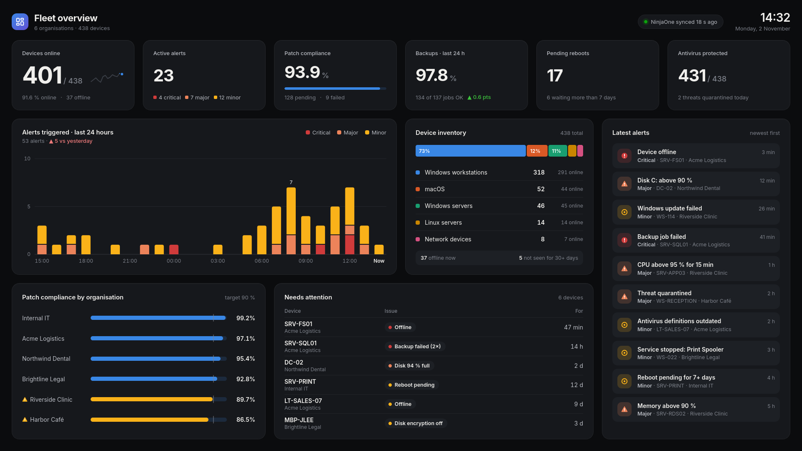

# NinjaDash: plan

A calm, good-looking wall dashboard for NinjaOne. An old MSI mini PC drives a TV or monitor
in kiosk mode. It pulls data from the NinjaOne public API and shows the whole fleet on one
screen that you can read from across the room.



Light theme: [`preview/dashboard-light.png`](preview/dashboard-light.png). The live mockup is in
[`mockup/index.html`](mockup/index.html). It's a single file you can open in a browser
(add `?theme=light` to the URL for the light theme). All data in it is made up.

---

## 1. Design goals

| Goal | What it means in practice |
|---|---|
| **Glanceable from 3 m** | One hero number, big KPI values, nothing smaller than 12 px. You can tell whether something is wrong in under 2 s. |
| **Calm by default** | Dark, low-contrast surfaces. Colour is used only where it means something: status (critical / major / minor / OK). Everything else is neutral ink plus one blue accent. |
| **Informational, not decorative** | Every panel answers a question an admin actually asks (see §2). No 3D, no gauges, no pie charts. |
| **One screen, no interaction** | No scrolling and no clicking needed. It's a wall display, so hover is a bonus, not a requirement. |
| **Kind to old hardware** | Plain HTML/CSS/SVG with no frontend framework or build step. Redraws only when data changes. |

## 2. Layout (1920 × 1080, 12-column grid, 20 px gaps)

```
┌──────────────────────────────────────────────────────────────────────────────────┐
│ ▣ Fleet overview                            ● NinjaOne synced 18 s ago   14:32 │
│   6 organisations · 438 devices                                Monday, 2 Nov   │
├────────────┬────────────┬────────────┬────────────┬────────────┬────────────┤
│ Devices    │ Active     │ Patch      │ Backups    │ Pending    │ Antivirus  │
│ online     │ alerts     │ compliance │ last 24 h  │ reboots    │ protected  │
│ 401/438 ⌇  │ 23         │ 93.9 % ▬▬  │ 97.8 %     │ 17         │ 431/438    │
├────────────┴────────────┴───────┬────┴────────────┬───────────┴────────────┤
│ Alerts triggered · last 24 h    │ Device inventory │ Latest alerts          │
│ stacked columns per hour,       │ segmented bar by │ live feed, newest      │
│ by severity                     │ OS + list        │ first, icon + severity │
├─────────────────────┬───────────┴──────────────────┤ word + device + org    │
│ Patch compliance    │ Needs attention              │ + time ago             │
│ by organisation     │ devices with a problem state │                        │
│ (90 % target mark)  │ (offline, disk, backup, …)   │                        │
└─────────────────────┴──────────────────────────────┴────────────────────────┘
```

| Panel | Question it answers | Form | NinjaOne source (to verify in phase 1) |
|---|---|---|---|
| Header sync pill | Is the data fresh? | Green dot, turns amber after 5 min and red after 15 | backend's own last sync time |
| **Devices online** (hero) | Is the fleet up? | Hero number + 14-day sparkline | `GET /v2/devices` → `offline` flag; trend from our own history DB |
| Active alerts | How bad is it right now? | Number + severity breakdown | `GET /v2/alerts` → `severity` |
| Patch compliance | Are we patched? | % + meter + pending / failed | `GET /v2/queries/os-patches`, `/v2/queries/os-patch-installs` |
| Backups · 24 h | Did last night's backups run? | % + ok/total + delta | `GET /v2/backup/jobs` (only if NinjaOne Backup is used) |
| Pending reboots | What is waiting on a restart? | Count + overdue count | device health / pending-reboot fields |
| Antivirus | Is everything protected? | protected / total + threats | `GET /v2/queries/antivirus-status`, `/v2/queries/antivirus-threats` |
| Alerts · 24 h | Is today normal? | Stacked columns, critical on the baseline | alerts + our own history (the API has no alert history) |
| Device inventory | What do we manage? | Segmented bar + list with online counts | `GET /v2/devices` → `nodeClass` |
| Latest alerts | What just happened? | Feed with icon + severity word | `GET /v2/alerts` sorted by `createTime` |
| Patch by org | Which customer is behind? | Bars with a 90 % target mark; below target turns amber with a ⚠ | patch queries grouped by `organizationId` |
| Needs attention | Which devices do I fix first? | Table with a status pill and how long | offline > 30 min, disk > 90 %, backup failed, reboot > 7 d, encryption off |

### Visual system

- **Font:** Inter (self-hosted on the mini PC so it works offline), tabular figures only in columns and axes.
- **Surfaces:** page `#0b0c0e`, cards `#16181c`, 18 px radius, hairline borders. The light theme is in the same file.
- **Status colours, used for nothing else:** critical `#d03b3b`, major `#ec835a`, minor/warning `#fab219`, good `#0ca30c`. They always appear with an icon or a word, never colour alone.
- **Category colours (device types):** blue, orange, aqua, yellow, magenta, in that fixed order. Checked for colour-blind separation in both themes.
- **Charts:** thin bars (≤ 22 px), a 4 px rounded top, a 2 px gap between stacked parts, hairline grid, and a label only on the peak.

## 3. Architecture

```
NinjaOne cloud API  (OAuth2 client-credentials, read-only "monitoring" scope)
        │  HTTPS, polled
        ▼
┌─────────────────────── MSI mini PC ─────────────────────────────┐
│  ninjadash-backend (Python 3 · FastAPI · httpx, systemd)        │
│   ├─ poller: alerts/devices every 60 s, patches/AV/backups 10 m │
│   ├─ SQLite: hourly snapshots → sparklines, "vs yesterday"      │
│   └─ GET /api/summary  (one JSON blob, same shape as mockup)    │
│        │ http://127.0.0.1:8080                                  │
│        ▼                                                        │
│  cage (Wayland kiosk) → Chromium --kiosk  (autologin on tty1)   │
└─────────────────────────────────────────────────────────────────┘
        │ HDMI
        ▼
      TV / monitor
```

Why this stack:
- **Secrets stay server-side.** The NinjaOne client secret never reaches the browser.
- **One poller, not one per browser.** This keeps us well under API rate limits, even if a second screen or a laptop also opens the page.
- **History is ours.** NinjaOne's API returns current state. Sparklines and "vs yesterday" need our own small snapshot DB.
- **Light enough for an old Celeron/Atom with 4 GB RAM.** Debian minimal + cage + Chromium idles at around 400 MB. Firefox kiosk is the fallback if Chromium is too heavy.

## 4. Phases

| # | Phase | Output |
|---|---|---|
| 0 | **Plan + design** (this PR) | Folders, this plan, mockup, preview images |
| 1 | **API spike** | Create a NinjaOne API client (machine-to-machine, `monitoring` scope). Write a script that dumps real responses to `cache/samples/`. Confirm every field in the §2 table. |
| 2 | **Backend** | Token handling + refresh, poller, SQLite history, `/api/summary`, `/healthz`, retries with backoff |
| 3 | **Frontend** | Turn the mockup into `frontend/` and fetch `/api/summary` every 30 s. Add stale-data banner, empty and error states, auto light/dark by time of day |
| 4 | **Kiosk** | Install guide for the mini PC (Debian 13 minimal), systemd units, autologin, screen off at night (`wlr-randr` / HDMI-CEC), auto-reboot weekly |
| 5 | **Polish** (optional) | A second rotating page (per-organisation detail), a 1 px pixel shift against burn-in, and a sound or flash on a new critical alert |

## 5. Folder layout

```
backend/        Python service: NinjaOne client, poller, history DB, JSON API
frontend/       Static dashboard page (HTML/CSS/vanilla JS), fonts in assets/
deploy/         Kiosk setup: systemd units, cage/Chromium launcher, install script
config/         .env.example (real .env is gitignored)
docs/           This plan, mockup, preview images
```

## 6. Open questions (answers change the build)

1. **Which NinjaOne region** is your instance on: `app` (US), `eu`, `ca`, `oc` or `us2`?
2. **Which screen**? 1080p TV, 4K, or a portrait monitor? The layout is 1080p-first and scales up cleanly.
3. **Do you use NinjaOne Backup and Ticketing?** If not, the Backups tile becomes something else (for example, open tickets or disk-space warnings).
4. **Exact mini PC model / CPU / RAM.** This decides Chromium vs Firefox and the OS image.
5. **Dark only, or switch to light during office hours?**
